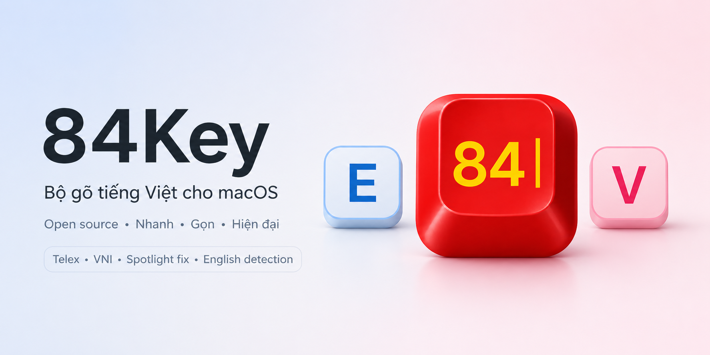

# 84Key




**Tiếng Việt** · [English](#english)

84Key là bộ gõ tiếng Việt miễn phí, mã nguồn mở dành cho macOS và Linux.

Tên gọi "84Key" lấy cảm hứng từ mã vùng điện thoại quốc tế +84 của Việt Nam.
84Key sử dụng lại engine gõ tiếng Việt viết bằng C++ của
[OpenKey](https://github.com/tuyenvm/OpenKey) và đóng gói trong một ứng dụng
SwiftUI hiện đại trên thanh menu của macOS và một bộ gõ IBus trên Linux, bổ sung
hai cải tiến nổi bật: tự động nhận diện từ tiếng Anh và sửa lỗi đặt dấu trong
Spotlight.

> Hỗ trợ macOS và Linux (IBus: Ubuntu, Debian, Fedora…). Windows sẽ được hỗ trợ
> trong tương lai.

## Tính năng

- **Gõ tiếng Việt chính xác** với các kiểu gõ Telex, VNI và Simple Telex, dựa
  trên engine OpenKey đã được kiểm chứng.
- **Tự động nhận diện tiếng Anh** — khi bạn gõ một từ tiếng Anh trong kiểu
  Telex, 84Key nhận ra và bỏ qua việc bỏ dấu, nên những từ như "feed" hay
  "tools" hiển thị đúng mà không phải tắt bộ gõ.
- **Sửa lỗi Spotlight** (macOS) — sửa vị trí dấu trong Spotlight và các ứng
  dụng xử lý sai chữ tổ hợp, nhờ Accessibility API của macOS.
- **Ứng dụng thanh menu** (macOS) — ứng dụng SwiftUI gọn nhẹ nằm trên thanh
  menu, có phần cài đặt và hướng dẫn cấp quyền Trợ năng (Accessibility).
- **Bộ gõ IBus cho Linux** — chạy trên X11 lẫn Wayland, trong mọi ứng dụng dùng
  IBus. Từ đang gõ được ghép trong vùng soạn thảo (gạch chân) rồi gửi đi trọn
  vẹn, nên không bị lặp chữ, mất dấu hay dán qua clipboard. Chuyển Việt/Anh bằng
  Ctrl + Shift; thanh trên cùng hiện **VI** / **EN**.
- **Nhiều bảng mã** — Unicode (mặc định), TCVN3, VNI-Windows, Unicode tổ hợp và
  CP1258.
- **Tự động cập nhật** (macOS) — ứng dụng tự kiểm tra và cài bản mới qua
  Sparkle, có chữ ký EdDSA để xác minh; bạn cũng có thể kiểm tra thủ công từ
  menu.
- **Không thu thập dữ liệu.**

## Quyền riêng tư

84Key hoạt động **hoàn toàn cục bộ** trên máy của bạn.

- **Không gửi dữ liệu thống kê.** 84Key không thu thập dữ liệu sử dụng.
- **Không kết nối mạng khi gõ.** Những gì bạn gõ không bao giờ được gửi đi đâu.
- **Không tài khoản, không theo dõi.**

84Key cần quyền **Trợ năng (Accessibility)** của macOS để hoạt động, vì ứng
dụng dùng `CGEvent` tap để đọc và thay thế văn bản khi bạn gõ. Quyền này chỉ
được dùng ngay trên máy để gõ tiếng Việt chính xác và sửa lỗi Spotlight. 84Key
chủ động không can thiệp vào các ô nhập mật khẩu (secure input).

Trên Linux, 84Key là một bộ gõ IBus: chỉ nhận những phím IBus chuyển tới khi bạn
đang chọn 84Key, không cần quyền đặc biệt nào, và cũng không can thiệp vào ô mật
khẩu.

## Tải về & cài đặt

### macOS

1. Tải bản `84Key.dmg` mới nhất từ trang
   [Releases](https://github.com/nghialuong/84Key/releases). Bản phát hành đã được
   ký và công chứng (notarized) bởi Apple nên mở ra không bị cảnh báo Gatekeeper.
2. Mở tệp `.dmg`, kéo **84Key** vào thư mục **Applications**, rồi mở ứng dụng.
3. Cấp quyền **Trợ năng** khi được yêu cầu
   (System Settings → Privacy & Security → Accessibility). Phần hướng dẫn sẽ chỉ
   bạn từng bước.
4. **Tắt các bộ gõ tiếng Việt khác** như OpenKey hoặc EVKey khi dùng 84Key. Chạy
   nhiều bộ gõ cùng lúc sẽ gây xung đột phím và sai chữ.

Sau khi cài, 84Key **tự cập nhật** lên bản mới (qua Sparkle); bạn cũng có thể
chọn *Kiểm tra cập nhật…* trong menu để kiểm tra ngay.

> Nâng cao: bạn có thể tự build từ mã nguồn — xem mục **Building** ở phần tiếng
> Anh bên dưới.

### Linux (Ubuntu 24.04 trở lên, Debian 13)

1. Tải tệp `ibus-84key_<phiên bản>_amd64.deb` từ trang
   [Releases](https://github.com/nghialuong/84Key/releases), rồi chạy:

   ```sh
   sudo apt install ./ibus-84key_*_amd64.deb
   ibus restart
   ```

2. Mở ứng dụng **84Key** và bấm **Thêm 84Key**, hoặc vào Settings → Keyboard →
   Input Sources → **+** → Vietnamese → **84Key**.
3. **Gỡ các bộ gõ tiếng Việt khác** (Unikey, Bamboo…) khỏi danh sách nguồn nhập;
   ứng dụng 84Key có nút để làm việc này.

Bản phân phối khác: tự build từ mã nguồn. Hướng dẫn đầy đủ, khác biệt so với
macOS và cách xử lý sự cố: [`docs/LINUX.md`](docs/LINUX.md).

### Windows

Chưa hỗ trợ — sẽ có trong tương lai. Engine gõ tiếng Việt đã viết bằng C++ độc
lập nền tảng để chuẩn bị cho việc này.

> Mã định danh ứng dụng (bundle id): `com.nghialuong.key84`.

## Ghi công

- **[OpenKey](https://github.com/tuyenvm/OpenKey)** của Mai Vũ Tuyên — engine
  gõ tiếng Việt làm nền tảng cho 84Key (giấy phép GPLv3).
- **[google-10000-english](https://github.com/first20hours/google-10000-english)**
  — danh sách từ tiếng Anh dùng cho tính năng nhận diện tiếng Anh (public
  domain / MIT).
- **[Sparkle](https://github.com/sparkle-project/Sparkle)** — framework tự động
  cập nhật trong ứng dụng (giấy phép MIT).

## Giấy phép

84Key được phát hành theo giấy phép **GNU General Public License v3.0 (GPLv3)**.
Xem tệp [LICENSE](LICENSE) để biết toàn văn.

Vì 84Key dùng lại engine từ OpenKey (vốn theo GPLv3), 84Key cũng phải giữ giấy
phép GPLv3.

---

# English


A free, open-source Vietnamese input method (bộ gõ tiếng Việt) for macOS and Linux.

84Key takes its name from Vietnam's +84 international calling code. It reuses
the proven [OpenKey](https://github.com/tuyenvm/OpenKey) C++ typing engine and
wraps it in a modern SwiftUI menu-bar app on macOS and an IBus input method on
Linux, adding two flagship improvements: automatic English-word detection and a
Spotlight diacritic-placement fix.

> macOS and Linux (IBus: Ubuntu, Debian, Fedora, ...). Windows is planned for the
> future.

## Features

- **Accurate Vietnamese typing** with Telex, VNI, and Simple Telex input
  methods, backed by the battle-tested OpenKey engine.
- **Smart automatic English detection** — when you type an English word in
  Telex, 84Key recognizes it and skips diacritic transformation, so words like
  "feed" or "tools" come out correctly without fighting the IME.
- **Spotlight fix** (macOS) — corrects diacritic placement inside Spotlight and
  other apps that mishandle composed input, using the macOS Accessibility API.
- **Menu-bar app** (macOS) — a lightweight SwiftUI app that lives in your menu
  bar with settings and a guided Accessibility onboarding flow.
- **IBus input method for Linux** — works under X11 and Wayland, in every
  application IBus reaches. The word being typed is composed in place
  (underlined) and committed whole, so letters are never doubled, tone marks are
  never dropped and nothing goes through the clipboard. Ctrl + Shift switches
  Vietnamese/English; the top bar shows **VI** / **EN**.
- **Multiple code tables** — Unicode (default), TCVN3, VNI-Windows, Unicode
  Compound, and CP1258.
- **Automatic updates** (macOS) — the app checks for and installs new versions
  via Sparkle, verified with an EdDSA signature; you can also check on demand
  from the menu.
- **No telemetry, ever** — 84Key does not phone home.

## Privacy

84Key is **100% local**. All keystroke processing happens on your computer.

- **No telemetry.** 84Key collects no usage data or analytics.
- **No network calls for typing.** Nothing you type is ever sent anywhere.
- **No accounts, no tracking.**

84Key requires the macOS **Accessibility** permission to function, because it
uses a `CGEvent` tap to read and replace text as you type. This permission is
used solely on-device to deliver correct Vietnamese input and the Spotlight
fix. 84Key intentionally avoids acting in secure-input/password fields.

On Linux, 84Key is an IBus input method: it only sees the keys IBus hands it
while 84Key is the selected input source, needs no special permission, and
leaves password fields alone.

## Download & install

### macOS

1. Download the latest `84Key.dmg` from the
   [Releases page](https://github.com/nghialuong/84Key/releases). Releases are
   signed and **notarized** by Apple, so they open with no Gatekeeper warning.
2. Open the `.dmg`, drag **84Key** into your **Applications** folder, then launch
   it. It appears in your menu bar.
3. Grant the **Accessibility** permission when prompted
   (System Settings → Privacy & Security → Accessibility). The onboarding flow
   guides you through this.
4. **Disable other Vietnamese IMEs** such as OpenKey or EVKey while using 84Key.
   Running more than one Vietnamese input method at the same time causes
   conflicting keystrokes and garbled output.

After installing, 84Key **keeps itself up to date** (via Sparkle); you can also
pick *Kiểm tra cập nhật…* from the menu to check immediately.

> Advanced: you can also build from source — see **Building** below.

### Linux (Ubuntu 24.04 or newer, Debian 13)

1. Download `ibus-84key_<version>_amd64.deb` from the
   [Releases page](https://github.com/nghialuong/84Key/releases), then:

   ```sh
   sudo apt install ./ibus-84key_*_amd64.deb
   ibus restart
   ```

2. Open the **84Key** app and click **Thêm 84Key**, or go to Settings →
   Keyboard → Input Sources → **+** → Vietnamese → **84Key**.
3. **Remove other Vietnamese input sources** (Unikey, Bamboo, ...); the 84Key
   app has a button for it.

Other distributions: build from source. Full guide, differences from macOS and
troubleshooting: [`docs/LINUX.md`](docs/LINUX.md).

### Windows

Not supported yet — planned for the future. The typing engine is already
platform-independent C++ to make this possible.

> Bundle identifier: `com.nghialuong.key84`.

## Building

macOS requirements: **Xcode** and **[XcodeGen](https://github.com/yonsm/XcodeGen)**
(`brew install xcodegen`) to generate the Xcode project. Linux requirements: a
C++17 compiler, **CMake** and the IBus development files (`libibus-1.0-dev`).

- **C++ engine tests** (platform-independent, also run in CI):

  ```sh
  bash core/tests/run_tests.sh
  ```

- **macOS app:**

  ```sh
  cd platform/macos
  xcodegen generate            # regenerate 84Key.xcodeproj from project.yml
  xcodebuild -scheme 84Key -configuration Debug CODE_SIGNING_ALLOWED=NO build
  ```

- **Linux IBus engine** (and a `.deb` with `cpack`):

  ```sh
  cmake -S platform/linux -B build/linux -DCMAKE_INSTALL_PREFIX=/usr
  cmake --build build/linux
  ctest --test-dir build/linux
  ```

- **Regenerate the dictionaries** (English from google-10000-english, Vietnamese
  from rules):

  ```sh
  python3 tools/gen_dict.py
  ```

See [`docs/OVERVIEW.md`](docs/OVERVIEW.md) for a plain-language product and feature
reference, [`docs/BUILD.md`](docs/BUILD.md) for build details,
[`docs/RELEASE.md`](docs/RELEASE.md) for the automated signed-and-notarized DMG release,
[`docs/ARCHITECTURE.md`](docs/ARCHITECTURE.md) for how the engine and app fit together,
[`docs/TESTING.md`](docs/TESTING.md) for the test suites (engine harness, keystroke
simulation with drop-in `cases/*.txt` fixtures, and the live end-to-end checks), and
[`docs/LINUX.md`](docs/LINUX.md) for the Linux version.

Notarized distribution requires an Apple Developer account; local development
builds do not. Pushing a `v*` tag publishes a notarized DMG and the Linux `.deb` —
see [`docs/RELEASE.md`](docs/RELEASE.md).

## Credits

- **[OpenKey](https://github.com/tuyenvm/OpenKey)** by Mai Vũ Tuyên — the
  Vietnamese typing engine that powers 84Key. Licensed under GPLv3.
- **[google-10000-english](https://github.com/first20hours/google-10000-english)**
  — the English word list used for automatic English detection (public domain /
  MIT).
- **[Sparkle](https://github.com/sparkle-project/Sparkle)** — the in-app
  auto-update framework (MIT).

## License

84Key is licensed under the **GNU General Public License v3.0 (GPLv3)**. See the
[LICENSE](LICENSE) file for the full text.

Because 84Key derives its typing engine from OpenKey, which is GPLv3, 84Key
must remain GPLv3. See [NOTICE](NOTICE) for attribution details.
